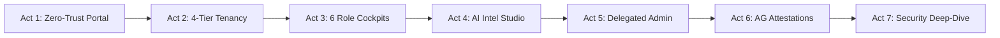

# 🇿🇦 SITA Cyber Security Intelligence Platform — Executive Demo Runbook

> **Target Audience**: State Information Technology Agency (SITA) Executive Leadership, Auditor-General (AG) Audit Committee, National Treasury, and Department of Home Affairs (DHA) Security Stakeholders.  
> **Status**: **Verified End-to-End** — 100% Automated Test Pass (28 test suites) · 2,249 Live Telemetry Findings Seeded.

---

## 🚀 One-Command Demo Launcher

To launch the full demonstration environment:

```powershell
python demo_launcher.py
```

### What this does automatically:
1. **Validates PostgreSQL Database**: Checks port 5432 and verifies the 2,249 live telemetry findings.
2. **Starts FastAPI Backend**: Serves REST endpoints, security headers, and AI intel routes on `http://127.0.0.1:8000`.
3. **Starts Vite React Frontend**: Serves the unified web app on `http://localhost:3000`.
4. **Verifies Health Endpoints**: Automatically verifies `/health` and frontend HTTP responses.
5. **Launches Default Browser**: Opens `http://localhost:3000` with the embedded **SITA Demo Co-Pilot HUD**.

---

## 🎯 Live Demo Script: The 7 Acts

The frontend features an embedded **SITA Demo Co-Pilot HUD** (bottom-right corner) that allows you to advance Act-by-Act with one-click transitions and executive talking points.



---

### Act 1: 🏠 Zero-Trust Landing Page & Public Summary
- **URL**: [http://localhost:3000](http://localhost:3000)
- **Executive Pitch**: Republic-wide transparency without exposing operational telemetry.
- **Key Visual**: The **14 Roles × 5 Capabilities RBAC Matrix** visually demonstrating strict separation of duty between National leadership, provincial administrations, and operational DDG units.
- **Enterprise Controls**: Browser DevTools inspection reveals hardened headers (`Content-Security-Policy`, `HSTS`, `X-Frame-Options: DENY`, `COEP/COOP`).

---

### Act 2: 🔐 Multi-Tier Authentication & Tenancy Cascade
- **Key Feature**: One-click persona switcher across all 14 authorized roles.
- **The 4 Tiers**:
  1. **Tier 4 — SITA Command Center** (`admin@example.com` / `operator@example.com`): Overarching platform provider.
  2. **Tier 3 — National Security Estate** (`exec@example.com`, `compliance@example.com`, `sre@example.com`): Whole-of-government visibility.
  3. **Tier 2 — Department Superuser Tenancy** (`deptadmin-ha@example.com`): Cryptographically jailed to DHA.
  4. **Tier 1 — Operational DDG Branches** (`soc-ha@example.com`, `appsec-ha@example.com`, `dbsec-ha@example.com`, `branchadmin-ha@example.com`): DHA Civic Services, Immigration, CCSS, etc.
- **Demonstration**: Show how the UI dynamically transforms between whole-estate national metrics and DHA branch-isolated telemetry.

---

### Act 3: 📊 6 Purpose-Built Security Cockpits
- **Executive Dashboard** (`/national/exec`): Fused Risk Score gauge (CVSS × Exposure × Blast Radius), Application Risk Heatmap, and interactive **"Explain This"** narrative.
- **SOC Analyst Dashboard** (`/dept/soc`): High-velocity real-time telemetry from HCL AppScan, Imperva WAF, and Thales DAM.
- **AppSec Dashboard** (`/dept/appsec`): Continuous vulnerability trends mapped directly to **OWASP Top 10 2021/2023** with remediation velocity tracking.
- **DbSec Dashboard** (`/dept/dbsec`): Database Activity Monitoring (DAM), Cassandra/PostgreSQL cluster inventory, and sensitive PII tracking.
- **Compliance Dashboard** (`/national/compliance`): POPIA, ISO 27001, and Auditor-General audit readiness indices.
- **SRE Dashboard** (`/national/sre`): Real-time microservice SLO metrics and live OEM connector health.

---

### Act 4: 🧠 AI Intelligence Engine & Two-Gate Verification
- **URL**: [http://localhost:3000/national/ai](http://localhost:3000/national/ai)
- **The 8 Analytical Capabilities**:
  1. **Author Attribution**: Git-blame style root-cause vulnerability attribution.
  2. **Threat Campaign Attribution**: Unifying disparate findings across SAST, DAST, and WAF into cohesive adversary campaigns.
  3. **POPIA Section 22 Breach Dossier**: Automated impact evaluation for Information Regulator notifications.
  4. **Risk-Delta Causal Attribution**: Explaining exact drivers behind weekly risk fluctuations.
  5. **Behavioural Sequence Analysis**: Detecting anomalous user/service access patterns.
  6. **VAPT Log Interpretation**: Automated mapping of penetration testing logs to production mitigations.
  7. **Capability Manifest**: Real-time transparency showing deterministic core vs. residue capabilities.
  8. **AI Report Studio**: G2 AI Report Generation Engine with Two-Gate verification.
- **Governance**: Every output is explicitly tagged `⚠ ADVISORY ONLY` with POPIA Zero-Log guarantees.

---

### Act 5: 👥 Delegated User Management & Authoritative HR Verification
- **URL**: [http://localhost:3000/sita/admin](http://localhost:3000/sita/admin)
- **Delegation Cascade**: Strict mathematical rule — an administrator can *never* provision roles at or above their own tier, nor widen tenancy scope beyond their assigned node.
- **HR Verification Integration**: Direct connector support for **SITA SAP HCM** and **National Treasury PERSAL**.
- **Mandatory Person Binding**: Operator accounts must bind to an authoritative government Person ID and PERSAL number before activation.
- **Immutable Audit Log**: Every grant, revocation, and scope modification is permanently recorded.

---

### Act 6: 📤 Export & Reporting Engine
- **Auditor-General Attestations**: Cryptographically signed SHA-256 compliance exports verifying immutable data state.
- **Executive Deliverables**: Pre-formatted Word briefs (`.docx`), multi-sheet styled workbooks (`.xlsx`), and raw telemetry CSVs.
- **Transversal Benchmarking**: Peer-group comparison comparing DHA security posture against transversal national averages while preserving tenant privacy.

---

### Act 7: 🔒 Technical & Architecture Deep-Dive
- **Microservice Architecture**: 6 independent Docker services (`backend`, `ingestion`, `processing`, `dispatch`, `analytics`, `frontend`).
- **Resiliency**: Token-bucket rate limiting, circuit breaker protection for third-party inference, and Dead Letter Queues (DLQ).
- **Hardening**: Null-byte injection filtering, strict JWT `alg:none` refusal, field-level AES-256 PII encryption.
- **Automated Verification**: 28 automated pytest test suites covering tenancy isolation, cryptographics, and OWASP pipeline.

---

## 🎥 Demonstration Verification Artifacts

- **Browser Verification Recording**: `sita_demo_verification_1793095240832.webp`
- **Slide Deck Briefing**: `http://localhost:3000/presentation.html`
- **Architecture Model**: `http://localhost:3000/architecture.html`
- **Handover Presentation**: `http://localhost:3000/handover_presentation.html`
