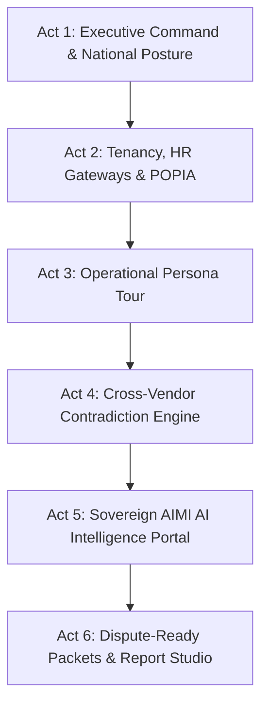

# SITA Consolidated Security Intelligence Platform (AIMI)
## End-to-End Proof of Concept (PoC) & Executive Sales Demonstration Runbook
**Target Audience**: SITA Executive Committee (ExCo), Chief Information Security Officer (CISO), Chief Technology Officer (CTO), National Cybersecurity Advisory Panel, and Government Department ICT Leadership (DHA, Treasury, SAPS, Presidency).  
**Presenters**: Solution Architects & Lead Engineering Team  
**System Status**: Fully Operational (Live FastAPI Backend on port 8000 · Vite React Portal on port 3000 · Live PostgreSQL Warehouse with 2,249+ findings, 15,283+ risk scores, 173 departments, 347 branches, 9 provinces).

---

## Executive Summary & Strategic Value Proposition

### 1. The Core Problem Facing SITA & The South African Government
- **Fragmented Tool Sprawl**: Government organs of state run disparate OEM solutions (HCL AppScan for DAST/SAST, Imperva for WAF/DAM, Noname for API Security, Thales for HSM/Crypto) operating in total isolation. SITA has had no unified visibility into the National Security Estate.
- **Cross-Vendor Blind Spots**: When AppScan identifies a critical Remote Code Execution (RCE) in an immigration portal, there is no automatic correlation to verify if Imperva WAF is blocking exploit attempts or if the endpoint is an unmanaged shadow API.
- **Compliance & Auditor-General Exposure**: Organs of state struggle to satisfy Auditor-General (AG) audits, POPIA s.10/13 data-minimization mandates, and ISO 27001 requirements due to lack of tamper-evident cryptographic evidence.
- **Sovereignty & AI Risk**: Public sector agencies cannot send national security logs or sensitive citizen data to public foreign LLMs (e.g. OpenAI/Anthropic) without severe legal liability under POPIA and the Protection of State Information Act.

### 2. The Solution: The SITA Consolidated Security & Intelligence Platform
This platform delivers a **sovereign, multi-tenant cybersecurity command and intelligence ecosystem** designed specifically for South African state governance:
1. **Four-Tier Sovereign Tenancy & Granular RBAC**: SITA Command Center (Tier 4) $\rightarrow$ National Security Estate (Tier 3) $\rightarrow$ Department Superadmin (Tier 2) $\rightarrow$ Branch Operational Admin (Tier 1).
2. **Authoritative HR Integration with POPIA Data Minimization**: Direct gateway access to **SITA SAP HCM API** (SITA employees) and **National Treasury PERSAL Gateway** (government personnel). Extracts strictly **surname, position, and employee code**, scrubbing national ID numbers, salary notches, and home addresses at the boundary.
3. **Multi-Source Data Fusion**: Normalizes and correlates AppScan, Imperva WAF, Imperva DAM, and API Security feeds into a unified risk scoring engine.
4. **Deterministic Cybersecurity Ground Truth**: Real-time MITRE ATT&CK coverage mapping, cross-vendor contradiction detection, and blast radius exposure analytics.
5. **AIMI Sovereign AI Intelligence & 4-Layer Control Model**: In-estate reasoning engines with automated fact-checking verification (zero hallucinations) and POPIA zero-log redaction.
6. **Cryptographic Dispute-Ready Packets**: Offline ECDSA-signed evidence packages verifiable by external auditors and the Auditor-General.

---

## Demo Personas & Instant Login Directory

The platform features built-in credential pre-sets across the four administrative tiers and all operational roles:

| Tier / Role | Display Name | Email / Username | Password | Purpose in Demo |
|:---|:---|:---|:---|:---|
| **Tier 4 · SITA Command Center** | Sipho Mthembu (Lead Architect) | `sita.superadmin@sita.co.za` | `Password123!` | Platform-wide root oversight, cross-estate analytics, transversal tenant delegation |
| **Tier 3 · National Estate** | Pravin Govender (Transversal Lead) | `national.superadmin@gov.za` | `Password123!` | Multi-department orchestration, national policy enforcement, compliance posture |
| **Tier 3 · National Executive** | Bongani Khumalo (Presidency) | `exec@presidency.gov.za` | `Password123!` | High-level risk posture, financial exposure, peer benchmarks |
| **Tier 3 · Compliance & AG** | Compliance Officer | `compliance@sita.co.za` | `Password123!` | POPIA & ISO 27001 readiness, gap register, audit trails |
| **Tier 3 · SRE & Infrastructure** | Johan Coetzee (Platform Ops) | `johan.coetzee@sita.co.za` | `Password123!` | Ingestion pipeline health, agent heartbeats, system latency |
| **Tier 2 · Department Superadmin** | Lindiwe Mazibuko (Chief Director) | `dha.superadmin@dha.gov.za` | `Password123!` | Department of Home Affairs (DHA) testbed superadmin; tenant-scoped delegation |
| **Tier 1 · Branch Superadmin** | Nkosinathi Dlamini (Director) | `dha.immigration.admin@dha.gov.za` | `Password123!` | DHA Immigration operational branch admin; localized user provisioning |
| **Operational · SOC Analyst** | Thandi Zwane (Senior SOC) | `thandi.zwane@sita.co.za` | `Password123!` | Real-time threat triage, kill-chain progression, MTTD/MTTR |
| **Operational · AppSec Engineer** | Willem Botha (Principal AppSec) | `dha.immigration.appsec@dha.gov.za` | `Password123!` | DAST/SAST vulnerabilities, CVEs, 30-day remediation fix rate |
| **Operational · DbSec Specialist** | Kagiso Mokoena (Civic DB Sec) | `dha.civic.dbsec@dha.gov.za` | `Password123!` | Database inventory, DAM agent telemetry, sensitive table queries |

---

## The 6-Act Golden Demo Script (Step-by-Step)

---

### Act 1: The Executive Command Center & National Posture
**Time**: 4–5 Minutes  
**Persona**: National Executive (`exec@presidency.gov.za`) / National Superadmin  
**URL**: `http://localhost:3000/exec`

#### Demo Steps:
1. **Open the Executive Dashboard**: Point out the live telemetry banner showing **2,249 Active Findings**, **389 Applications**, **2,577 Databases**, and **9 Healthy Connectors**.
2. **Explain the Fused Risk Score Engine**:
   - Highlight that risk is **not a single vendor score**.
   - Show the dynamic signal weights: **AppScan Severity (35%)**, **Imperva Database Violations (25%)**, **API Exposure (20%)**, and **Compliance Gaps (20%)**.
3. **Demonstrate Peer Benchmarking Across Organs of State**:
   - Scroll to the **Tenancy Benchmark Module** (`/benchmark` / Exec view).
   - Show how the platform allows the Presidency or SITA ExCo to compare cybersecurity posture across departments (Home Affairs vs Treasury vs SAPS) without exposing underlying sensitive payload data.
4. **Demonstrate Theme Flexibility**:
   - Click the theme toggle (🌙 Dark Mode / ☀️ High-Contrast Light Mode) to show accessibility compliance for executive briefing rooms and daylight projection.

#### Presenter Talking Point:
> *"Distinguished executives, what you are seeing is the first unified pane of glass for the South African National Security Estate. SITA can now observe aggregated risk across all 173 government departments and 347 branches in real time. We are fusing application vulnerabilities, database attacks, shadow APIs, and compliance deficiencies into an objective, mathematical risk posture."*

---

### Act 2: Sovereign Tenancy, External HR Gateways & Real-Time Provisioning
**Time**: 5–6 Minutes  
**Persona**: SITA Superadmin (`sita.superadmin@sita.co.za`) $\rightarrow$ DHA Superadmin (`dha.superadmin@dha.gov.za`)  
**URL**: `http://localhost:3000/sita/admin` $\rightarrow$ `http://localhost:3000/dept/admin`

#### Demo Steps:
1. **Show the 4-Tier Administrative Hierarchy**:
   - Navigate to `/sita/admin` (Tier 4). Point out the authority badge: `SITA Command Center — Transversal Superadmin`.
   - Explain the cascade: SITA can grant transversal authority; Department Superadmins can only grant within their department; Branch Admins can only grant within their specific DDG branch.
2. **Open the "Create User" Modal**:
   - Click **+ Create User**.
   - Point out the **⚡ Real-Time Demo Assistant**: click **Auto-Fill Demo Credentials** to show how the system pre-populates valid identities.
3. **Demonstrate Live External HR Integration & POPIA Data Minimization**:
   - In the modal, show the **Authoritative External HR Integration** box.
   - Click **🏢 SITA Employee System (SAP HCM)**: Type `Mthembu` or `SIT-00101`. Show the live result returning *Sipho Mthembu (Lead Security Architect)*.
   - Click **🏛️ National Treasury PERSAL Gateway**: Type `Mazibuko` or `80491024`. Show the live result returning *Lindiwe Mazibuko (Chief Director: Identity Systems & DHA Superadmin)*.
   - Highlight the **POPIA s.10/13 Compliance Badge**:
     `[🛡️ POPIA s.10/13 Minimized: Surname, Position & Code retained. ID number, salary notch, and private address are strictly stripped at the API boundary.]`
   - Select an employee: observe how `display_name`, `email`, `department_ids`, and `branch_ids` are instantly auto-configured with zero manual typing errors.
4. **Demonstrate the Anti-Cross-Tenant Provisioning Gate**:
   - Explain that if a DHA Department Admin attempts to provision an account linked to a Treasury employee or grant a National Executive role, the backend rejects it with an HTTP 403 authorization error. The system enforces strict tenancy boundaries.

#### Presenter Talking Point:
> *"Notice the rigor of our identity architecture. SITA does not store duplicate HR records or sensitive citizen/employee data like ID numbers or salary notches—that violates POPIA s.10. Instead, our platform connects via real-time API gateways to SITA's SAP HCM and National Treasury's PERSAL, pulling only the minimal identity needed for RBAC accountability. Furthermore, delegation is mathematically gated: no department can provision outside its sovereign boundary."*

---

### Act 3: Operational Persona Tour (SOC, AppSec, DbSec, SRE)
**Time**: 6–7 Minutes  
**Personas**: Switching via the Top Navigation / Role Selector  
**URLs**: `/soc` · `/appsec` · `/dbsec` · `/sre` · `/compliance`

#### Demo Steps:
1. **SOC Analyst Dashboard (`/soc`)**:
   - Log in or switch to SOC role (`thandi.zwane@sita.co.za`).
   - Highlight the **Real-Time Threat Feed**: 551 active alerts categorized by severity.
   - Show the **Kill Chain Progression widget**: Reconnaissance $\rightarrow$ Initial Access $\rightarrow$ Privilege Escalation $\rightarrow$ Data Exfiltration.
   - Review **Mean Time to Detect (MTTD)** and **Mean Time to Remediate (MTTR)** metrics.
2. **AppSec Engineer Dashboard (`/appsec`)**:
   - Switch to AppSec role (`dha.immigration.appsec@dha.gov.za`).
   - Point out the **HCL AppScan Cloud live integration**: 2,249 vulnerability findings.
   - Show the **OWASP Top 10 Distribution** (A01 Broken Access Control, A03 Injection, A07 Identification Failures).
   - Review the **Critical Findings Table**: each finding displays external AppScan ID, CVE identifier, CVSS score, and affected application (`ehomeaffairs-portal`, `digital-identity-platform`).
   - Highlight the **30-Day Remediation Fix Rate**.
3. **Database Security Specialist Dashboard (`/dbsec`)**:
   - Switch to DbSec role (`dha.civic.dbsec@dha.gov.za`).
   - Show the **2,577 Monitored Databases** and active **Imperva DAM telemetry**.
   - View unauthorized SQL queries, privileged user escalation attempts, and sensitive citizen data access logs.
4. **Platform SRE & Infrastructure Dashboard (`/sre`)**:
   - Switch to SRE role (`johan.coetzee@sita.co.za`).
   - Review the **9 Connector Health Statuses** (AppScan, Imperva WAF, Imperva DAM, APISec, Thales, SITA HCM, PERSAL).
   - Show the **171 Agent Heartbeats** across edge collectors and worker processes.

#### Presenter Talking Point:
> *"Instead of logging into four separate vendor consoles with four different sets of credentials, our operational teams work within a single role-optimized interface. AppSec engineers see their DAST/SAST findings with CVEs; database specialists monitor DAM telemetry; SOC analysts triage alerts; and SREs monitor pipeline health. Everything is synchronized."*

---

### Act 4: The Deterministic Threat Intelligence & Contradiction Engine
**Time**: 4–5 Minutes  
**Persona**: Transversal Security Architect / SITA Superadmin  
**URL**: `http://localhost:3000/national/ai` (Intelligence Tab) or via API `/api/v1/intel/*`

#### Demo Steps:
1. **Show the Cross-OEM Contradiction Engine** (`GET /api/v1/intel/vendor/contradictions`):
   - Explain how the platform performs mathematical set differences across security tools.
   - **Scenario A**: AppScan discovers a Critical SQL Injection on `ehomeaffairs-portal/api/v1/identity`, but Imperva WAF has no corresponding active rule protecting that URI.
   - **Scenario B**: APISec detects an active API endpoint receiving 50,000 requests per day that has **zero DAST scan coverage** (Shadow API discovery).
2. **Demonstrate MITRE ATT&CK Matrix Coverage** (`GET /api/v1/intel/attack/coverage`):
   - Show how findings (via CWE IDs) are automatically mapped against defensive detection rules.
   - Point out areas where defensive blue-team rules fail to cover red-team vulnerability exposures.
3. **Show Estate Ownership & Blast Radius Analysis** (`GET /api/v1/intel/estate/ownership`):
   - Demonstrate how an attack on a shared authentication service in the SITA Command Center impacts downstream departments (Home Affairs, SAPS, Treasury).

#### Presenter Talking Point:
> *"Here is where SITA saves millions of Rands. This is our Deterministic Contradiction Engine. We don't just collect logs—we cross-examine our vendors. If AppScan finds an exploit but our WAF is blind to it, the platform flags a Cross-Vendor Contradiction. SITA can now verify whether the OEM tools it paid for are actually working together."*

---

### Act 5: Sovereign AIMI AI Security Intelligence & The 4-Layer Control Model
**Time**: 5–6 Minutes  
**Persona**: National Superadmin / SOC Lead  
**URL**: `http://localhost:3000/national/ai`

#### Demo Steps:
1. **Explain the 4-Layer AI Governance Model**:
   - **Layer 1: Deterministic Ground Truth**: Mathematical aggregations, counts, and joins done in SQL/Python (never delegated to an LLM).
   - **Layer 2: POPIA Zero-Log Redactor**: Before any context reaches reasoning engines, all PII, IP addresses, tokens, and employee names are redacted.
   - **Layer 3: Bounded In-Estate Reasoning**: Specialized models restricted to 5 genuine cybersecurity analytical tasks (e.g. Predictive Breach Probability, Blast Radius Projection, Attack Attribution).
   - **Layer 4: Automated Verification Barrier**: Model outputs are checked against deterministic fact packs. If an AI hallucinates a finding ID, CVE, or score that does not exist in the database, the output is rejected.
2. **Demonstrate the AIMI AI Engines**:
   - Navigate to the **AI Reasoning Workspace**.
   - Select **Predictive Breach Probability**: Show how it calculates probability scores based on open vulnerabilities, public exploit availability, and active WAF probes.
   - Select **Blast Radius & Attack Path Engine**: Trace how a compromised border control terminal could pivot into the national civic registry.
   - Select **Causal Attribution Engine**: View how the engine attributes a surge in brute-force events to a coordinated external credential stuffing campaign.
3. **Highlight the Interactive Footlinks & Explanations**:
   - Click on each engine option: show the dynamic footlinks explaining exactly what each engine provides and which persona benefits from it.

#### Presenter Talking Point:
> *"Many vendors make vague promises about 'AI'. At SITA, national security requires absolute precision. We have implemented a 4-Layer AI Governance Model. Our AI never sees raw citizen data—it is governed by our POPIA Zero-Log Redactor. Furthermore, every output passes through an Automated Verification Barrier: if an AI hallucinates a single fact, it is intercepted and corrected against ground truth."*

---

### Act 6: AI Report Studio & Cryptographic Dispute-Ready Evidence Packets
**Time**: 4–5 Minutes  
**Persona**: Compliance Officer (`compliance@sita.co.za`) / Executive  
**URL**: `http://localhost:3000/national/ai` $\rightarrow$ AI Report Studio Tab

#### Demo Steps:
1. **Open the AI Report Studio**:
   - Show the persona report generator options:
     - 🏛️ **Executive Remediation Briefing**
     - 🛡️ **SOC Threat Intelligence Brief**
     - 🔧 **AppSec Vulnerability Playbook**
     - 📋 **Auditor-General & POPIA Compliance Dossier**
2. **Generate an Executive Remediation Brief**:
   - Click **Generate Report**.
   - Observe the live generation pipeline:
     `Fetching Fact Pack` $\rightarrow$ `Applying POPIA Minimality Redaction` $\rightarrow$ `Reasoning Model Synthesis` $\rightarrow$ `Fact-Checking Verification Barrier Passed (100% verified)` $\rightarrow$ `Rendered Output`.
   - Point out the structured executive sections: Executive Summary, Highest-Exposure Applications, Immediate 30-Day Action Items, and Strategic Investments.
3. **Demonstrate Cryptographic Dispute-Ready Packets (`POST /api/v1/intel/packet`)**:
   - Show how the compliance officer can generate a signed evidence packet.
   - Highlight the **ECDSA digital signature and SHA-256 hash**.
   - Explain that this packet can be given directly to the Auditor-General or Information Regulator as tamper-evident proof that SITA performed continuous compliance monitoring without human falsification.

#### Presenter Talking Point:
> *"When the Auditor-General audits SITA or a department, generating compliance evidence used to take weeks of manual spreadsheet compilation. With our AI Report Studio and Cryptographic Evidence Packets, SITA generates an offline-verifiable, ECDSA-signed compliance dossier in seconds. It is mathematically impossible to tamper with this evidence after the fact."*

---

## Executive Q&A & Objection Handling Guide

When presenting to SITA ExCo and government procurement committees, be prepared for these critical questions:

### Q1: "How does this platform comply with POPIA regarding government employee and citizen data?"
> **Answer**:  
> *"Our platform implements POPIA by design under Sections 10 and 13. First, we do not store citizen records—we only process cybersecurity telemetry. Second, for government employees and administrators, our gateway to PERSAL and SAP HCM extracts only three non-sensitive attributes: surname, job title, and employee code. Sensitive master records like South African ID numbers, residential addresses, and salary notches are stripped at the network boundary and never touch our storage. Third, all analytical logs are processed through our POPIA Zero-Log Redactor."*

### Q2: "Can SITA run this in an air-gapped or sovereign private cloud without internet connectivity to US AI APIs?"
> **Answer**:  
> *"Yes. The core platform—ingestion, normalization, fused risk scoring, MITRE ATT&CK mapping, and RBAC—is 100% deterministic and runs entirely on on-premise infrastructure or SITA Private Cloud (OpenStack / VMware / OpenShift). For the AIMI AI reasoning layer, our architecture supports local quantized open-weights models (e.g. Llama 3 or DeepSeek hosted within SITA’s Centurion or Erasmuskloof data centers). Zero data ever leaves the sovereign boundary of the Republic."*

### Q3: "What happens if a department like Treasury or SAPS refuses to let Home Affairs see their vulnerability data?"
> **Answer**:  
> *"Our Four-Tier Multi-Tenancy model guarantees strict data isolation. Database-level tenancy filters (`tenant_filter`) are enforced on every query. A DHA Department Admin cannot see, query, or export findings from Treasury, SAPS, or the Presidency. Only designated Tier 4 (SITA Command Center) and Tier 3 (National Transversal) superadmins have multi-tenant visibility, and all accesses are logged in immutable, cryptographically hashed access audit tables."*

### Q4: "How does this compare to simply buying IBM QRadar or Microsoft Sentinel?"
> **Answer**:  
> *"SIEM tools like QRadar or Sentinel are ingestion aggregators that charge exponentially by log ingestion volume and require millions of Rands in annual licensing fees. They do not understand South African government tenancy (PERSAL, DHA branches, provincial tiers), they do not cross-correlate AppScan findings against Imperva WAF rules, and they do not generate POPIA compliance evidence packs. Our platform is purpose-built for the South African State, eliminating OEM vendor lock-in and drastically lowering total cost of ownership."*

---

## Technical Verification & Pre-Flight Checklist

Before walking into the presentation, verify that:
1. **Backend Server**: Running on `http://localhost:8000` (FastAPI with PostgreSQL).
   - Test: `curl http://localhost:8000/api/v1/public/summary` returns HTTP 200 with 2,249+ findings.
2. **Frontend Portal**: Running on `http://localhost:3000` (Vite dev server).
   - Test: `http://localhost:3000` loads login screen cleanly.
3. **Database Telemetry**: Verified with `python backend/_db_check.py`:
   - `warehouse.findings`: $\ge$ 2,249
   - `warehouse.risk_scores`: $\ge$ 15,283
   - `warehouse.database_inventory`: $\ge$ 2,577
   - `warehouse.api_endpoints`: $\ge$ 2,752
4. **All 519 Automated Tests Passing**:
   - `pytest backend/tests/` passes with 0 failures.

---

## Presentation Conclusion & Next Steps

Close the meeting with a clear, low-risk procurement roadmap:
1. **Phase 1 (Immediate Proof-of-Value · 30 Days)**:
   - Connect live API keys for HCL AppScan Cloud and Imperva WAF on SITA’s pilot applications (`sita-portal`, `ehomeaffairs-portal`).
   - Validate real-time finding ingestion and cross-vendor contradiction detection.
2. **Phase 2 (Departmental Rollout · 60 Days)**:
   - Onboard Department of Home Affairs (DHA) as the primary transversal testbed.
   - Connect PERSAL Gateway for authoritative user provisioning.
3. **Phase 3 (National Security Estate Commissioning · 90 Days)**:
   - Commission SITA Command Center Tier 4 superadmin oversight for Treasury, SAPS, and Presidency.
   - Establish automated Auditor-General cryptographic compliance reporting.
